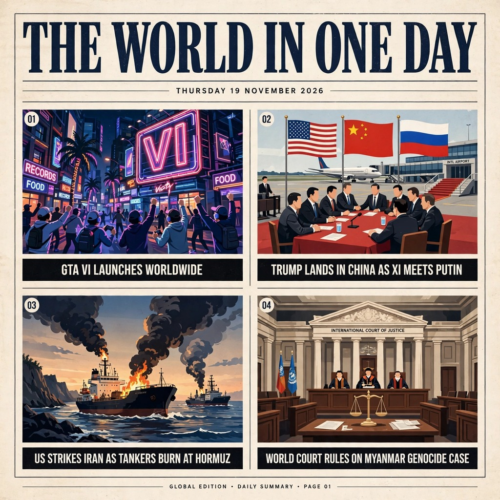

# World News — Thursday 19 November 2026

A newspaper front page summing up the world's news of Thursday 19 November
2026 in a single image. The masthead names the day, and four illustrated
panels cover the day's most consequential stories from four different beats:
a landmark entertainment launch, a high-stakes diplomatic triangle, a
military escalation in the Gulf, and a historic court ruling.

## The four stories

1. **GTA VI launches worldwide** — Rockstar's long-awaited Grand Theft Auto VI
   arrives, the biggest entertainment release of the year.
2. **Trump lands in China as Xi meets Putin** — the US president touches down
   in Beijing on the same day China's leader sits down with Russia's, a
   triangle of great-power diplomacy playing out in one day.
3. **US strikes Iran as tankers burn at Hormuz** — American strikes on Iran
   and burning tankers in the Strait of Hormuz, the day's sharpest escalation.
4. **World Court rules on Myanmar genocide case** — the International Court of
   Justice hands down its ruling in the genocide case against Myanmar.

## How it works

`main.ts` (Node 22, standard library only) reads `entry.png` from the
repository, checks it is a real JPEG or PNG and is not empty, then writes
those exact bytes to `entry.png` in the output directory
(`MAKEFUN_OUTPUT_DIR`, or `/output` by default), creating the directory if
needed. The output is deterministic: every run writes the same
368,273-byte, 1024×1024 JPEG image.
